# pyterrainwind

**Where terrain concentrates the wind, and what that costs a plant in water.**

Wind is the environmental dimension that gets left out, and it is left out because it
is awkward. Light is predictable: the sun's path is known centuries ahead, and aspect
does the rest. Wind arrives from a direction that changes week to week, is steered and
accelerated by the same ridges that sort the light, and strips moisture from leaves
whether or not the sun is shining. A tree leaning permanently east is reporting
something no radiation model can.

For a plant the mechanism is direct. Moving air thins the humid boundary layer at the
leaf surface, so the vapour gradient out of the stomata stays steep and transpiration
keeps running. That is why **midwinter demand here is mostly wind, not sun** — net
radiation has collapsed to near zero in June, but the air keeps moving, and the
aerodynamic share of reference evapotranspiration peaks near **61%**. A model with no
wind term reports a midwinter floor that is a lower bound, not an estimate.

This package adds that term, in three layers:

- **climatology** — what the wind does at a point, over years: speed and direction
  conventions, whether a mean direction means anything at all, a seasonal × daily
  harmonic model, and the gust shape that decides how often a damaging threshold is
  crossed.
- **exposure** — how terrain redistributes that wind across a block, by two
  deliberately different schemes: `sx_raster`, the upwind shelter angle, and
  `micromet_weight`, a slope-plus-curvature weighting that can also represent
  **speed-up over a crest**, not only shelter in a lee.
- **demand** — FAO-56 reference evapotranspiration, the wind-aware companion to the
  Priestley-Taylor model in `pyterrainsol`.

## Where this sits

Five small packages, one chain. Each does one thing and each is useful on its own.

| package | reads | gives you |
|---|---|---|
| [pylidarterrain](https://github.com/jborevitz/pylidarterrain) | classified airborne LiDAR | the ground surface a plant actually stands on: slope, aspect, how much sky it can see |
| [pyterrainsol](https://github.com/jborevitz/pyterrainsol) | that surface + daily weather | light and evaporative demand, cell by cell, day by day |
| **pyterrainwind** (this one) | that surface + reanalysis wind | **wind exposure, and the extra demand it carries** |
| [pychannelform](https://github.com/jborevitz/pychannelform) | that surface | where the water goes: catchments, channels, long profiles |
| [pylandstore](https://github.com/jborevitz/pylandstore) | channels + demand | where to hold water, and what it costs to move it uphill |

Requires [`pyterrainsol`](https://github.com/jborevitz/pyterrainsol) for net
radiation on the inclined, shaded surface. The dependency runs one way: wind needs
the light chain, the light chain never needs wind.

## Quickstart

```python
from pyterrainwind import (speed_direction, weibull_fit, sx_raster, micromet_weight,
                           vapour_pressure_deficit, wind_at_2m, penman_monteith)

speed, drct = speed_direction(uas, vas)              # m/s, degrees the wind comes FROM
k, c = weibull_fit(speed)                            # gust shape and scale

shelter = sx_raster(dem, res=3.0, bearings=rose_dirs, weights=rose_freq)   # degrees
weight  = micromet_weight(dem, res=3.0, bearings=rose_dirs, weights=rose_freq)

vpd = vapour_pressure_deficit(t_min_c, t_max_c, vp_kpa)          # kPa, NOT SILO's
et0 = penman_monteith(net_rad, t_mean_c, elevation_m,
                      wind_at_2m(speed, 10.0) * weight, vpd)      # mm/day per cell
```

## What it found at 845 Avonside

46.3 ha in the Snowy Monaro, NSW, 888-1197 m, on a 3 m LiDAR surface. Twenty years of
BARRA-C2 wind and SILO climate, 2006-2025.

### Two wind regimes, pushing water opposite ways

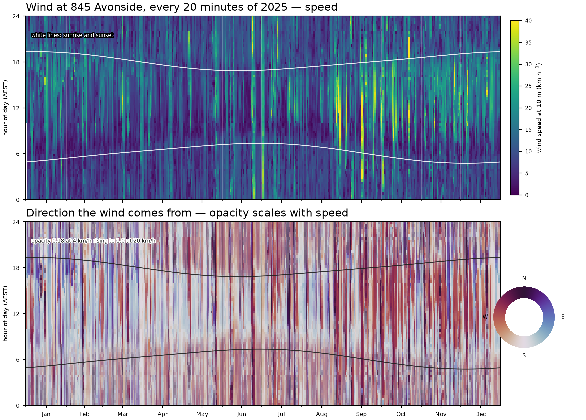

*2025 at 20-minute resolution: 365 days across, 72 steps of the day up, local time.*

The dark spring columns are a dry, fast north-westerly: of all steps above 36 km/h,
**89% come from WNW through NNW**. The pale pre-noon wedges from December to March
are a slow, humid easterly that rotates westerly by afternoon, a daily rotation
absent in June and July. The first raises real demand above what a wind-free model
reports, the second lowers it — so **a model without wind has an error that changes
sign with the season**, which is worse than one that is simply biased.

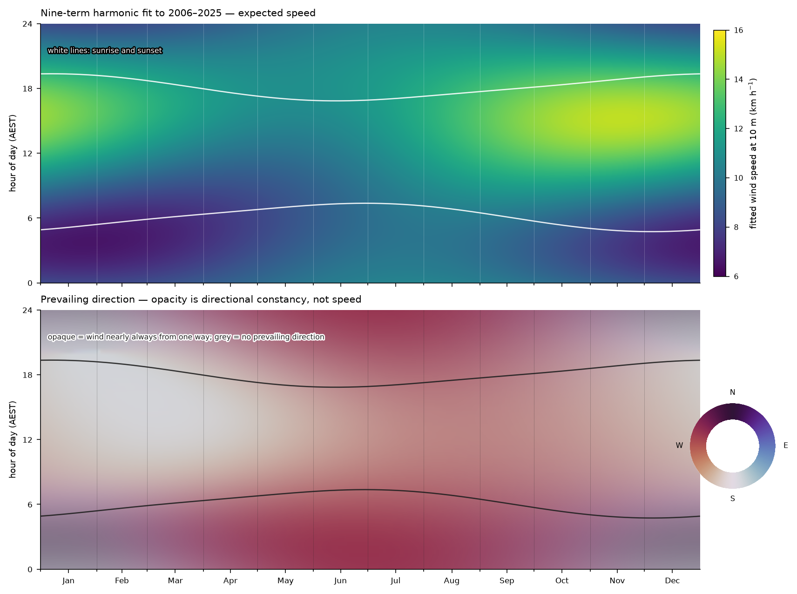

*The nine-term harmonic fit to 2006-2025, with opacity set by directional constancy
(0.00 to 0.81). The steadiest wind of the year is midwinter before dawn from 293°;
the least steady is a summer evening, which greys out because there genuinely is no
prevailing direction then. Fitted speed spans 6.6-15.1 km/h against an observed
0-70.2 — a climatology predicts the expectation, never the day.*

### A climatology of wind is mostly an admission

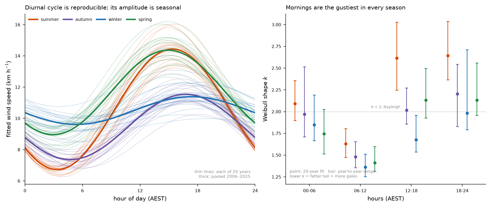

The nine-term model explains **10.0% of speed variance over twenty years**.
Climatology standard deviation is 2.01 km/h against a residual of 6.02, so synoptic
weather is three times the amplitude of the entire annual plus daily cycle. **2025
alone gave 15.3% and ranks first of twenty** on both fit and annual amplitude —
calibrating on it would have been calibrating on an outlier. For comparison, the same
kind of fit explains 69% of daily maximum temperature. Temperature has a season;
wind, here, mostly has weather.

| quantity | pooled | year-to-year sd | verdict |
|---|---|---|---|
| mean speed | 10.56 km/h | 0.36 | solid |
| diurnal amplitude | 2.33 km/h | 0.19 | solid |
| diurnal peak hour | 15.7 h local | 0.26 h | solid |
| diurnal amplitude, midsummer | 3.86 km/h | 0.40 | solid |
| annual amplitude | 1.10 km/h | **0.40** | weak |
| annual peak day | day 275 | **28 days** | do not interpret |

Gust *shape* held up where the harmonics did not, and shape is what breaks branches.
Per-bin Weibull `k` varies year to year by only 0.07-0.24, and **mornings carry the
lowest `k` in all four seasons** (1.36-1.63) — a genuine two-regime mixture of calm
nights and synoptic overrides. The consequence is counter-intuitive and matters for
anything with a damage threshold: summer afternoons have a *higher* mean than spring
mornings, 15.7 against 12.0 km/h, and yet **six times fewer hours above 30 km/h** —
0.44% against 2.62% — because `k` is 2.61 against 1.41. **Rank seasons by mean speed
and you can get their extremes backwards.**

Effective roughness from the 10 m / 50 m profile: median ratio 1.515, inverting to
**z0 ≈ 0.44 m**, ten times rougher than short grass, running 0.296 m from the south
to 0.449 m from the northwest.

### Where the wind comes from, and why the mountains are not in the model

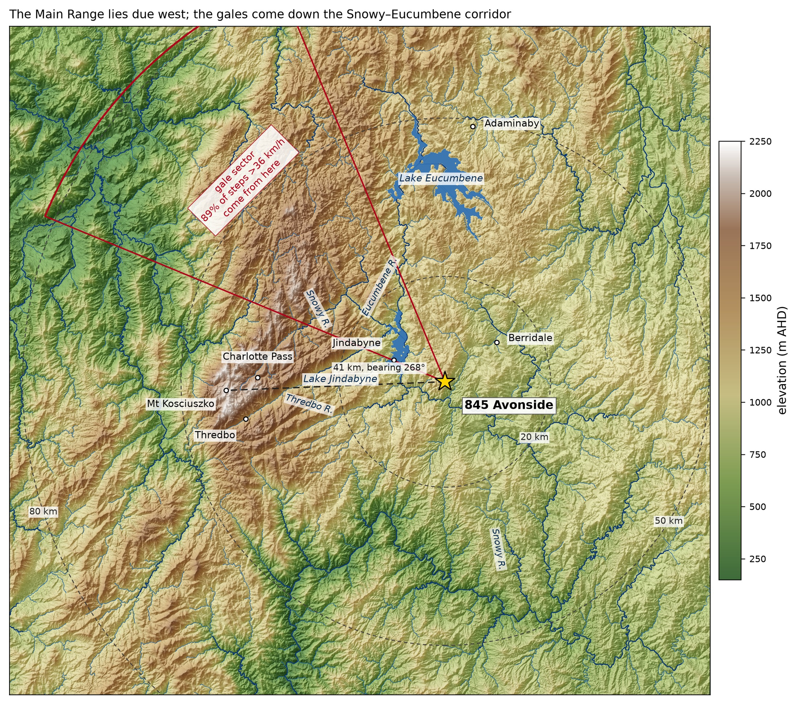

*The Main Range is 41.5 km away on a bearing of 268°, almost due west — and so sits
**outside** the 292.5-337.5° sector carrying 89% of the strong steps. The gales look
instead up the Snowy-Eucumbene corridor, a 1000-1200 m trench between the range and
the Monaro tableland. Tracing the Snowy from Charlotte Pass with a flow grid: 40.9 km
to Lake Jindabyne at 906 m, then a straight 15.8 km run to the farm, so air following
that line arrives from **314°** against a sector centre of 315. Nothing was tuned to
produce that.*

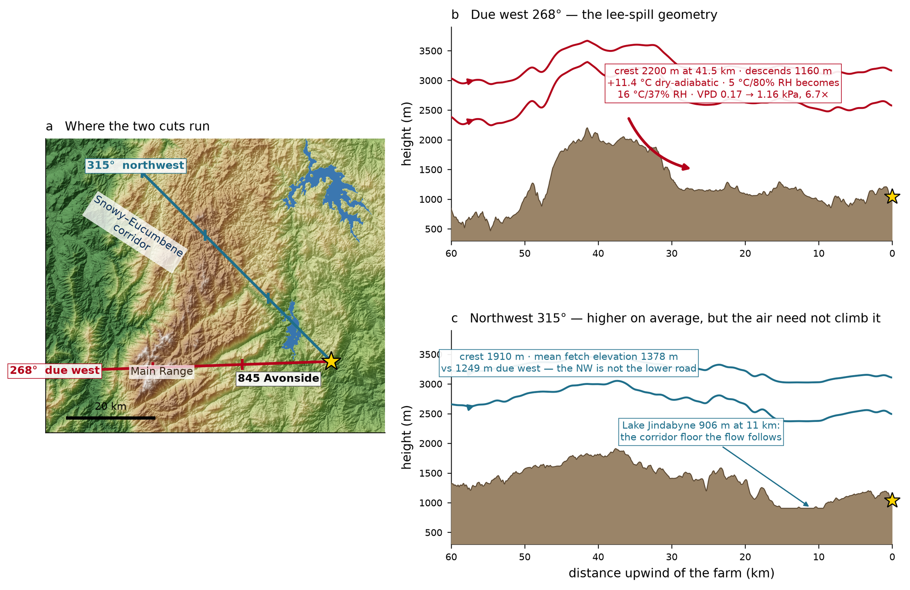

*Due west the air would have to cross a 2203 m crest and descend 1160 m, warming it
11.4 °C on the way down: a 5 °C, 80% RH parcel arrives at 16 °C and 37%, and its
vapour pressure deficit goes from 0.17 to 1.16 kPa — **6.7 times the drying power**.
That is what a resident means by feeling the mountains, and it is the load that kills
seedlings. The northwest ray is **not** the low road, though: mean elevation 1378 m
against 1249 m due west.*

**All of that is already in the forcing.** A 4.4 km reanalysis resolves the corridor
and hands over wind at the farm pixel with the channelling included; the temperature
and humidity record is the air mass that actually arrived, foehn warming and all.
This package reads regional terrain to *explain* the wind, never to *predict* it.
What a 4.4 km cell cannot contain is the last 500 m. That part is ours.

### Shelter is local, and the exposed ground is a narrow band

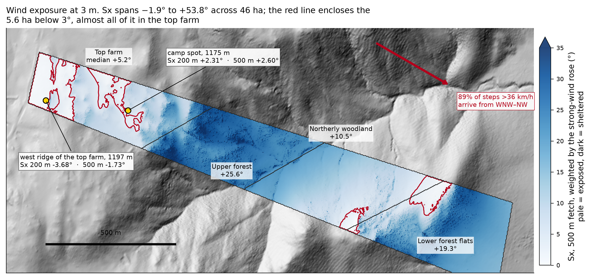

*The upwind shelter angle over a 500 m fetch, weighted by the strong-wind rose, on
the 3 m grid. It spans **-1.9° to +53.8°** across 46 ha. By part: top farm **+5.2**,
northerly woodland +10.5, lower forest flats +19.3, upper forest **+25.6**. The
west-facing ridge of the top farm at 1197 m reads **-1.73** — ground where the
horizon falls away upwind, with nothing between it and the weather.*

Measured, not assumed: **every bit of that shelter comes from within 1 km.** Averaged
over the gale sector the horizon angle over a 60 km fetch is 18.38°, and the terrain
within 1 km alone gives 18.38° — the same number. The Main Range contributes 1.4°. A
long fetch is for air-mass history, not for shelter, and a shelterbelt argument has to
be made at paddock scale or not at all.

### What the wind is worth, in water

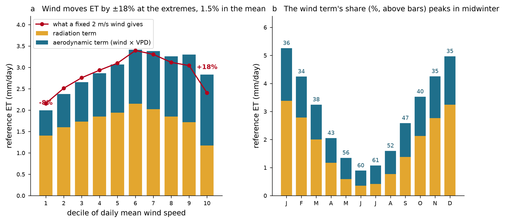

*Reference evapotranspiration comes to 1065 mm/yr against SILO's own 1043, daily
r = 0.991. The radiation term carries 637 mm/yr and the aerodynamic term 427.
Replacing the real wind with a fixed 2 m/s moves the **annual** total by only 15 mm —
but by -8% on the calmest decile of days and **+18% on the windiest**, +23% on the
windiest 5%. The wind term's share peaks in **midwinter at 61%**, when net radiation
has collapsed and air movement is nearly all the demand there is.*

So wind matters for the *distribution* of demand, not its annual total — which is
exactly the part a plant experiences. An annual mean hides the week that kills it.

### From degrees of arc to metres per second

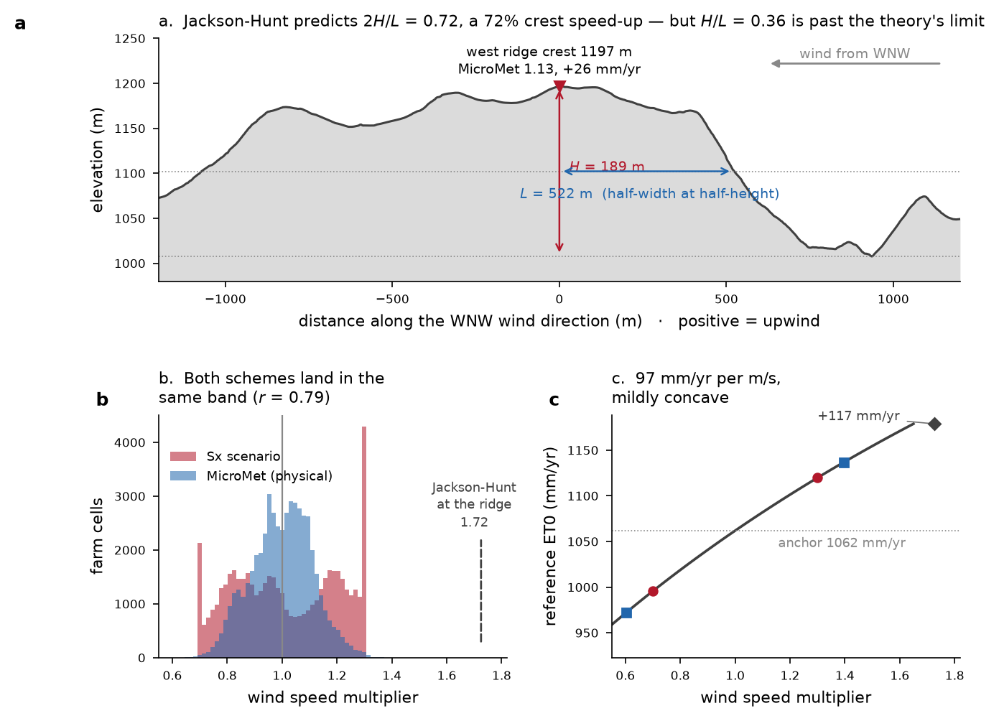

This was the honest gap in earlier versions of this work, and it is the step worth
being sceptical about. The shelter angle is **geometry, in degrees of arc**. For the
sun that geometry *is* the physics — below the horizon angle the beam is blocked, and
trigonometry converts degrees to MJ. Air is a fluid with inertia: it is not blocked
below a threshold, it separates, reattaches, and accelerates over a crest. Two
published schemes were tested against this terrain rather than assumed:

- **Jackson and Hunt (1975)** linear theory gives a crest speed-up of 2H/L. Fitted on
  the west ridge along the gale direction, H = 189 m and L = 522 m give
  **2H/L = 0.72, a +72% speed-up**. But H/L = 0.36 is past linear theory's validity
  near 0.3, and 49% of this block is steeper than that, so the flow separates and
  0.72 over-predicts.
- **Liston and Elder (2006)**, the MicroMet slope-plus-curvature weighting, gives
  **0.604 to 1.396** across the farm. That range is close to the ±30% scenario the
  shelter-angle route had been using, which is the useful result: **the magnitude was
  defensible even when the mechanism was asserted.**

The two schemes agree on *where* the wind goes better than expected, cell by cell at
**r = 0.79** over 51,467 cells. They are different physics — wake sheltering versus
attached-flow speed-up — but on this terrain they do not contradict each other. One
asymmetry is worth stating plainly: the shelter angle is **one-sided** by
construction and has no mechanism for speed-up at all, so any value above 1 in a
shelter-derived multiplier comes from re-centring on the field median, which is a
normalisation choice. MicroMet is genuinely two-sided.

### The map that follows, and what it says to do

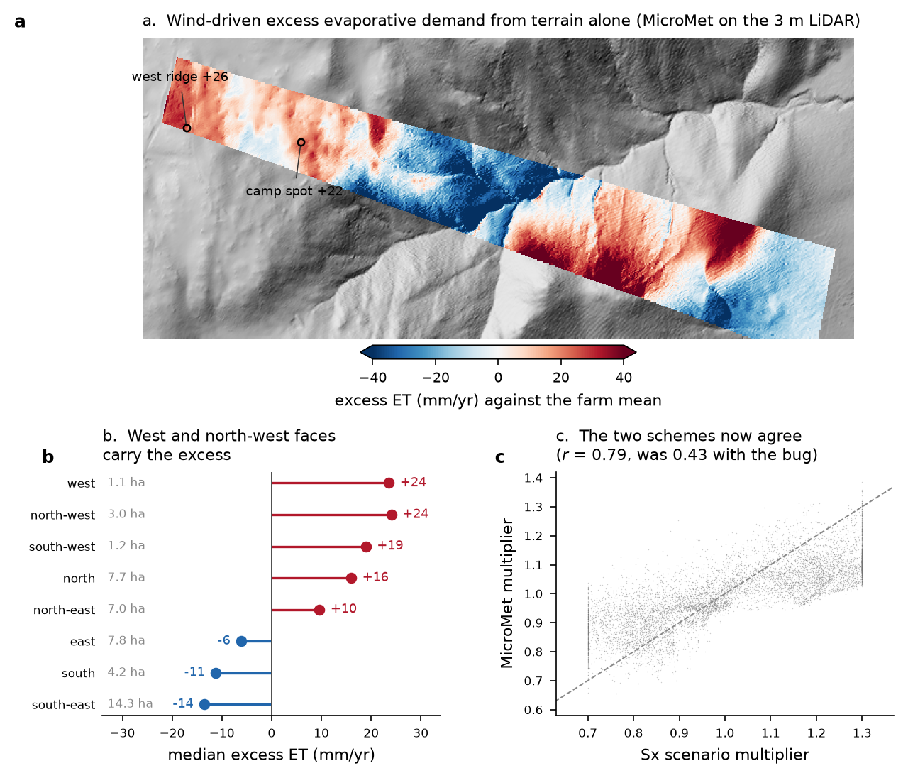

*Excess evapotranspiration attributable to terrain-redistributed wind, from MicroMet
on the 3 m surface: **-89 to +75 mm/yr** across the block, a 164 mm spread against a
1062 mm/yr baseline. By aspect, the median excess runs west **+24 mm/yr**, northwest
+24, southwest +19, north +16, northeast +10, east -6, south -11, southeast -14.*

Two things a manager can act on. First, **the exposed quarter is small**: west,
northwest and southwest together are only **5.3 ha of 46.3**. The high-wind ground is
a narrow ridge band, not a large block, so shelter planting is a targeted job rather
than a whole-farm one. Second, by part the excess is **top farm +11, northerly
woodland +12, upper forest -27, lower forest flats -9 mm/yr** — and those signs are
the same four signs the shelter-angle route gave, at a quarter to two thirds of the
amplitude. Two independent schemes agreeing on sign in all four parts is a stronger
claim than either number alone.

**Wind reinforces the radiation pattern rather than compensating for it.** Across the
four parts the correlation between radiation-driven demand and the wind delta is
**+0.84**, the part ranking does not change, and the between-part spread widens from
365 to **427 mm/yr**. The driest part gets drier and the wettest wetter. This is the
reason a whole-farm average is the wrong unit for this property: the two drivers
compound instead of cancelling.

### A year of it, and an average year

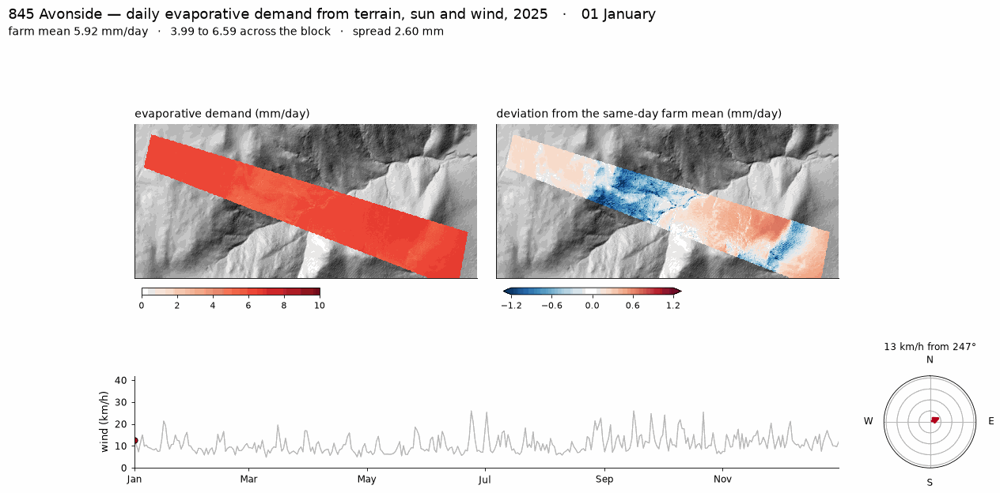

*2025 day by day with the real weather, on the 3 m grid. Left is absolute demand on a
linear 0-10 mm/day scale, white to red; right is the deviation from that same day's
farm mean, which is where the spatial story lives. The scale is deliberately linear:
a square-root ramp stretched the near-zero winter values and flattened the summer
days that actually move the water. Farm-mean demand runs **0.22 to 8.01 mm/day** and
totals **970 mm**. Every 6th day; daily version:
[avonside_et_wind_2025.mp4](https://raw.githubusercontent.com/jborevitz/pyterrainwind/main/docs/avonside_et_wind_2025.mp4).*

The number that justifies a 3 m grid: the spread across the block on a given day runs
0.47 to 3.75 mm/day, median 1.93, and **on 94% of days that spatial spread is larger
than the change from yesterday to today.** A single gauge would be tracking the
smaller of the two signals.

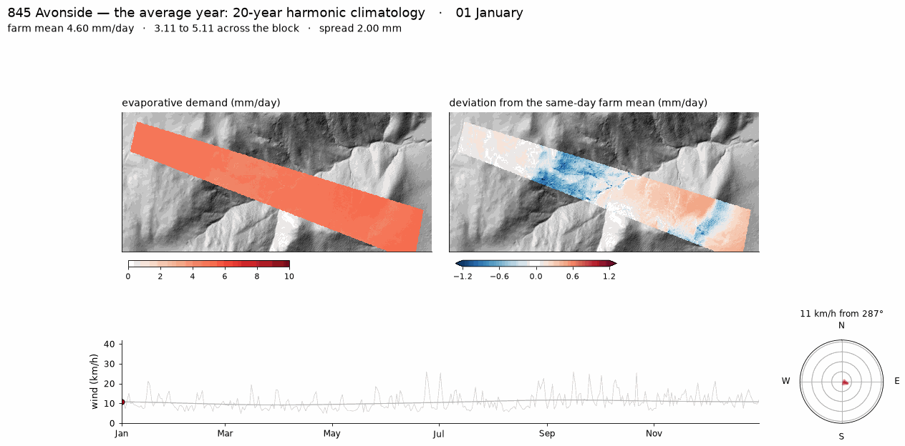

*The same model driven by a harmonic fit to twenty years of forcing — the year this
site has on average, with the weather removed. **904 mm** against 970 for 2025, so
2025 ran 7% high, consistent with the point record placing it 5% above the twenty-year
mean and 6th of 20. Daily version:
[avonside_et_climatology.mp4](https://raw.githubusercontent.com/jborevitz/pyterrainwind/main/docs/avonside_et_climatology.mp4).*

Per-cell annual demand in the average year spans **477 to 1096 mm**. By part: upper
forest 753, top farm 896, lower forest flats 901, northerly woodland 1045 mm/yr. The
terrain signal persists through the averaging — the north-facing woodland sits above
the farm mean and the gullies below it, all year — which is the point of modelling
exposure at all: weather is noisy, but terrain is fixed geometry, so its contribution
accumulates into a standing pattern.

## Data

[`data/`](data/) holds twenty years of BARRA-C2 wind at two heights, the fitted gust
and harmonic tables, and a regional 30 m DEM for upwind fetch, each with the script
that regenerates it and the traps worth knowing — timestamps in UTC, and why you must
never average a direction. See [`data/README.md`](data/README.md).

## Methods

The conventions this package enforces, the traps it exists to prevent, and what it
deliberately does not do are in **[`docs/methods.md`](docs/methods.md)**.

Methods and results are kept apart on purpose. The methods travel to any site and
will be re-checked against new ground and simulated data; the findings above are one
46 ha property in the Snowy Monaro, some of them specific to it and some likely to
generalise. Either can then be argued with without disturbing the other.

---

Extracted from [`pyterrainsol`](https://github.com/jborevitz/pyterrainsol) at commit
`8bd5630`, where the wind work was originally developed.
